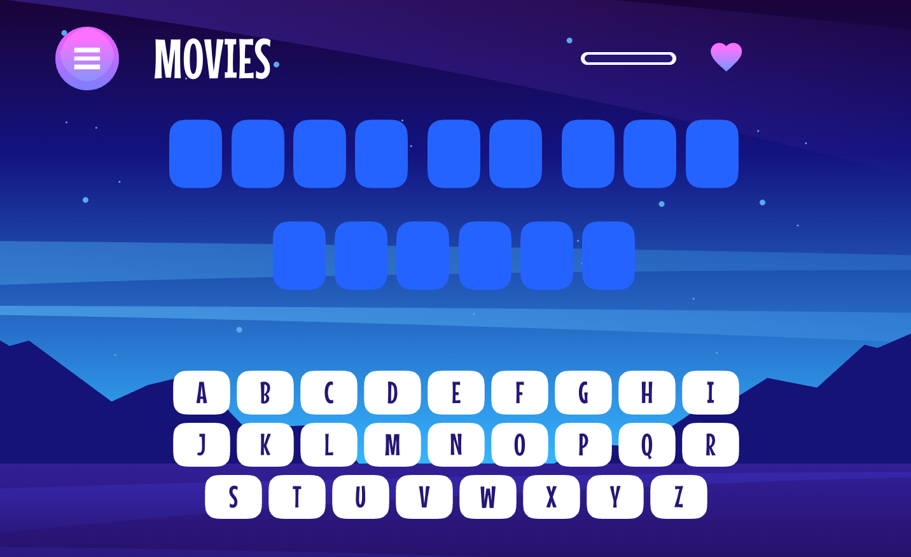

# Frontend Mentor - Hangman game solution

This is a solution to the [Hangman game challenge on Frontend Mentor](https://www.frontendmentor.io/challenges/hangman-game-rsQiSVLGWn).

## Table of contents

- [Overview](#overview)
  - [The challenge](#the-challenge)
  - [Screenshot](#screenshot)
  - [Links](#links)
- [My process](#my-process)
  - [Built with](#built-with)
  - [Getting started](#getting-started)
- [Author](#author)

## Overview

### The challenge

Users should be able to:

- Learn how to play Hangman from the main menu
- Start a game and choose a category
- Play Hangman with a random word selected from that category
- See their current health decrease based on incorrect letter guesses
- Win the game if they complete the whole word
- Lose the game if they make eight wrong guesses
- Pause the game and choose to continue, pick a new category, or quit
- View the optimal layout for the interface depending on their device's screen size
- See hover and focus states for all interactive elements on the page
- Navigate the entire game only using their keyboard

### Screenshot


### Links

- Solution URL: [GitHub](https://github.com/mansij-sunshine/hangman)
- Live Site URL: [Hangman](https://hangman-eta-rouge.vercel.app)

## My process

### Built with

- Semantic HTML5 markup
- CSS custom properties
- Flexbox
- Responsive design
- [React](https://reactjs.org/) - JS library
- [TypeScript](https://www.typescriptlang.org/) - Typed JavaScript
- [Vite](https://vite.dev/) - Build tool
- [Vitest](https://vitest.dev/), [React Testing Library](https://testing-library.com/) and [Playwright](https://playwright.dev/) - Unit and end-to-end testing

### Getting started

```bash
npm install
npm run dev
```

Other scripts: `npm run build`, `npm run lint`, `npm test`, `npm run e2e`.

## Author

- GitHub - [@mansij-sunshine](https://github.com/mansij-sunshine)
- Frontend Mentor - [@mansij-sunshine](https://www.frontendmentor.io/profile/mansij-sunshine)
